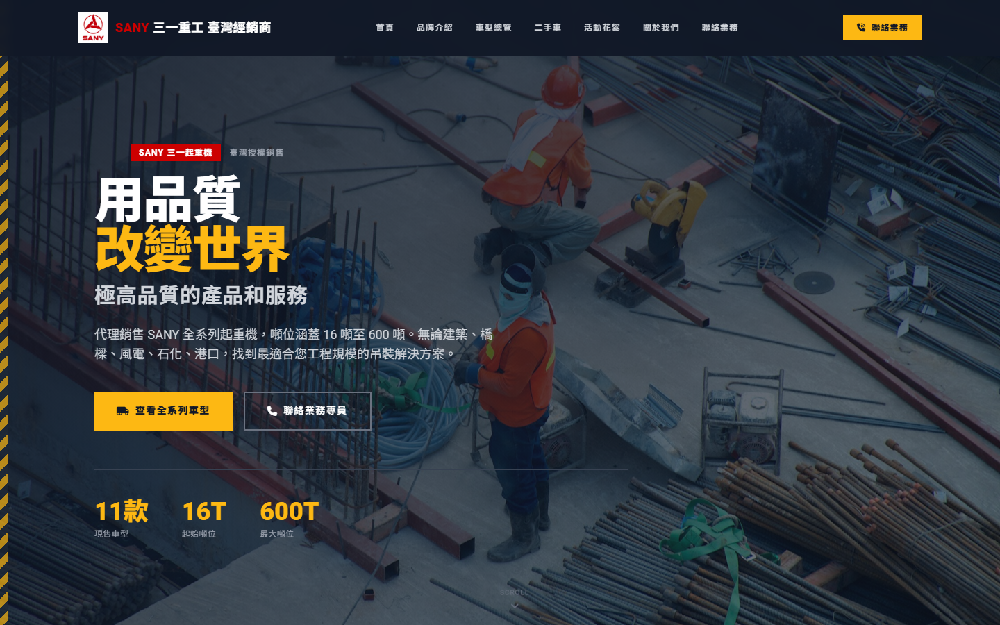
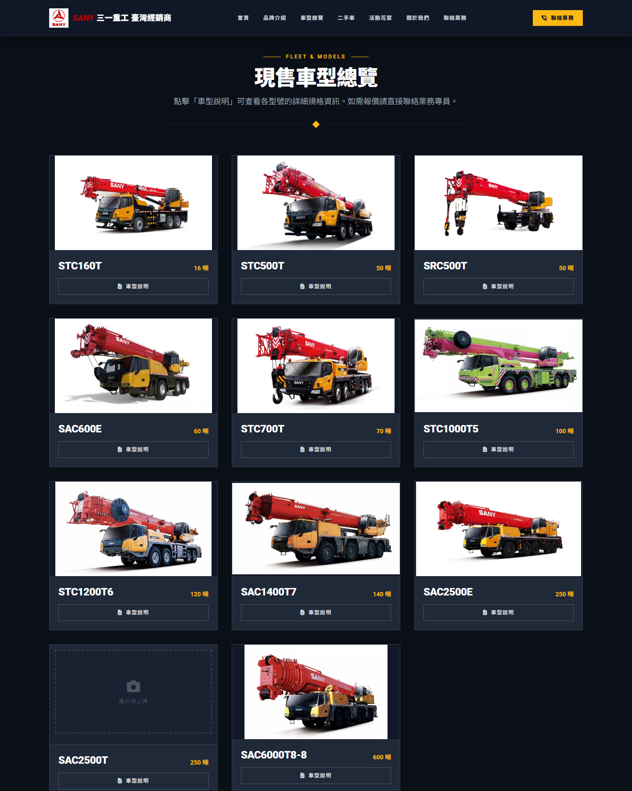
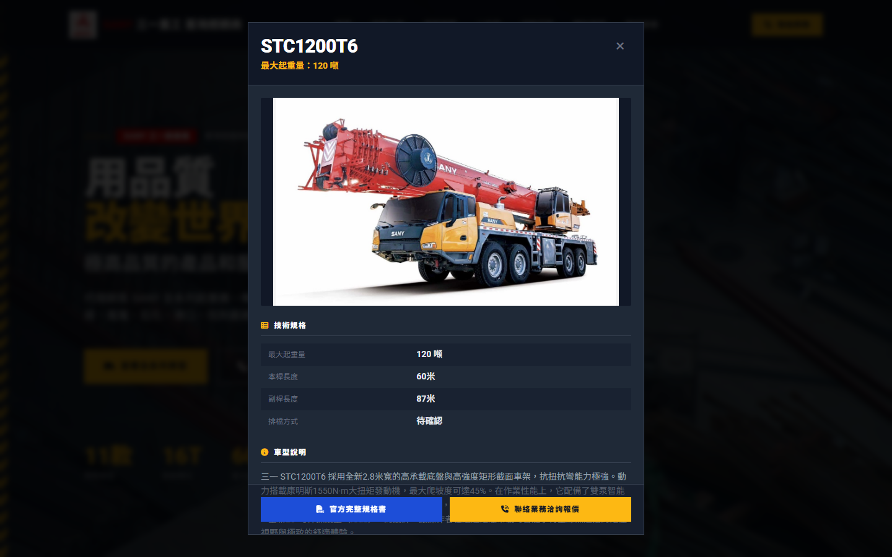
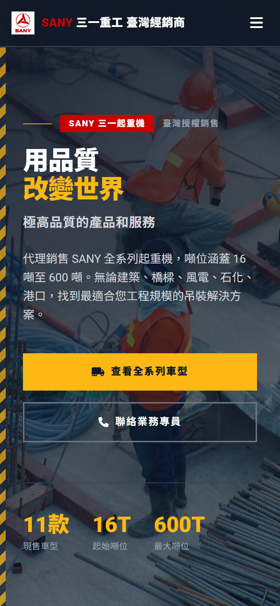
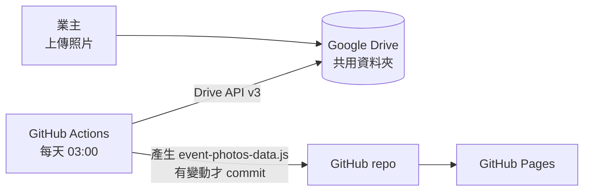

# I-Cheong Website — SANY 三一起重機臺灣經銷商官網

為 SANY 三一起重機臺灣授權經銷商製作的形象與產品型錄網站。
客戶可以瀏覽全系列車型規格、下載原廠規格書，並一鍵撥打電話或加 LINE 聯絡業務；
活動照片只要丟進 Google Drive 資料夾，網站每天會自動同步，業主不需要碰任何程式碼。

**線上版：** [ping-hsun-chiang.github.io/i-cheong-website](https://ping-hsun-chiang.github.io/i-cheong-website/)




---

## 要解決的問題

起重機買家多半是工程公司的採購或現場主管，常在工地用手機查資料。經銷商需要一個網站能：

- **快速比較車型：** 噸位從 16 噸到 600 噸，買家要能一眼看出各型號的噸位，並查到詳細規格與原廠規格書。
- **降低聯絡門檻：** 看到喜歡的車型，就能直接打電話或加 LINE，不需要填表單等回覆。
- **業主自己能更新：** 業主不會寫程式，但展覽與交車照片需要經常更新。

## 功能

- **車型總覽：** 11 款車型卡片依噸位排列，點「車型說明」開啟詳情視窗，包含圖片、規格表、車型介紹，
  以及原廠 PDF 規格書下載；沒有規格書的車型會自動停用下載按鈕。
- **二手車專區：** 由資料檔動態產生卡片，共用車型詳情視窗；目前沒有資料時會顯示「整理中」的提示。
- **活動花絮照片牆：** 從 Google Drive 自動同步，以 masonry 版面隨機排列、隨機微幅旋轉，
  呈現照片散落的感覺；點擊開啟 lightbox，可用鍵盤左右鍵切換。
- **聯絡業務：** 導覽列、首頁、車型詳情等處都有「聯絡業務」按鈕，開啟業務資訊視窗；
  電話使用 `tel:` 連結，手機上點了就能撥打，另有 LINE 加好友連結與 Google Maps 賞車地點。
- **響應式設計：** 手機版改為漢堡選單，卡片依螢幕寬度切換 1／2／3 欄。
- **捲動動畫：** 以 `IntersectionObserver` 讓各區塊進入畫面時淡入。

| 車型總覽 | 車型詳情視窗 |
| --- | --- |
|  |  |

<p align="center"></p>

## 設計重點

### 內容與版面分離

網站沒有後台，但把**會變動的內容**全部抽成獨立的資料檔，`index.html` 只負責版面與渲染：

| 資料檔 | 內容 | 更新方式 |
| --- | --- | --- |
| [`fleet-data.js`](fleet-data.js) | 新車規格：噸位、圖片、PDF、規格表、介紹 | 手動編輯，每個欄位都有註解說明 |
| [`used-car-data.js`](used-car-data.js) | 二手車資料，欄位與新車相同 | 手動編輯，附範例條目 |
| [`event-photos-data.js`](event-photos-data.js) | 活動照片清單 | **GitHub Actions 自動產生，不需手動編輯** |

新增一台車只要在資料檔多加一個物件，不需要理解 HTML 結構。

### 照片自動同步（Google Drive → 網站）



[`scripts/sync-event-photos.js`](scripts/sync-event-photos.js) 的流程：

1. 以 Google Drive API v3 列出資料夾內所有圖片，支援分頁（`nextPageToken`），並排除垃圾桶中的檔案。
2. 依修改時間由新到舊排序。
3. 利用 Drive 回傳的 `thumbnailLink`，把尺寸參數改寫成 **640px 縮圖**（照片牆）與 **1920px 大圖**（lightbox）兩種網址，
   不需要另外壓縮或儲存圖片，repo 也不會因為照片越來越大。
4. 寫成 `event-photos-data.js`；只有內容真的變動時，[workflow](.github/workflows/sync-event-photos.yml) 才會 commit。

API key 存放在 GitHub Secrets（`GDRIVE_API_KEY`），不會出現在程式碼中。

### 零建置（No build step）

整個網站是單一 HTML 檔，Tailwind CSS、Font Awesome、Google Fonts 都透過 CDN 載入。
沒有 `npm install`、沒有打包流程，push 之後 GitHub Pages 直接發布，維護成本最低。

## 架設與開發

**本機預覽：** 直接用瀏覽器開啟 `index.html`，或啟動任一靜態伺服器：

```bash
npx serve .
```

**設定照片同步：**

1. 在 Google Cloud Console 啟用 **Google Drive API**，建立 API key。
2. 將 Drive 資料夾設為「知道連結的人都能檢視」，並把資料夾 ID 填入 `scripts/sync-event-photos.js` 的 `FOLDER_ID`。
3. 在 repo 的 **Settings → Secrets and variables → Actions** 新增 `GDRIVE_API_KEY`。
4. 到 **Actions** 分頁手動執行一次 *Sync event photos from Google Drive*，確認同步成功。

本機測試同步腳本（需要 Node.js 18 以上，使用內建的 `fetch`）：

```bash
GDRIVE_API_KEY=xxx node scripts/sync-event-photos.js
```

**部署：** 在 **Settings → Pages** 選擇從 `main` branch 發布，之後每次 push 都會自動更新。

## 專案結構

```
index.html                 整個網站：版面、樣式、互動邏輯
fleet-data.js              新車規格資料
used-car-data.js           二手車資料
event-photos-data.js       活動照片清單（自動產生）
scripts/
  sync-event-photos.js     從 Google Drive 同步照片清單
.github/workflows/
  sync-event-photos.yml    每日排程執行同步
fig/                       車型圖片與 LOGO
PDF/                       原廠規格書
docs/screenshots/          README 使用的截圖
```

## 未來規劃

- 補齊 STC500T、STC700T、SRC500T、SAC2500E、SAC2500T 的車型介紹，以及 SAC2500T 的車輛圖片
- 二手車資料也改由 Google Drive／Google Sheets 同步，讓業主自行上架
- 加入 SEO 結構化資料（Product schema），提升搜尋引擎能見度
